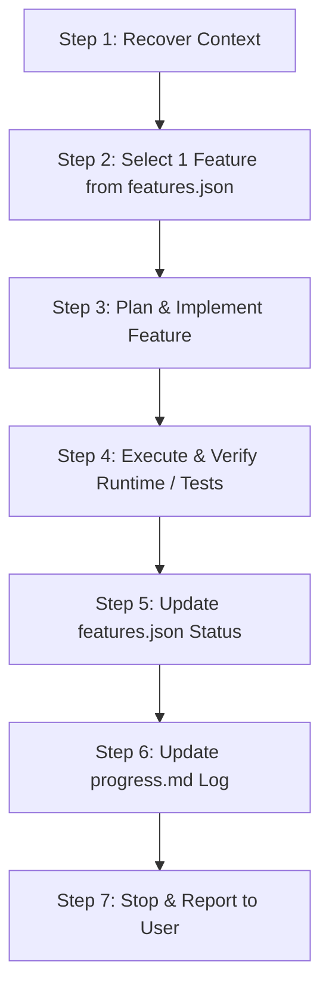

## graphify

This project has a knowledge graph at graphify-out/ with god nodes, community structure, and cross-file relationships.

When the user types `/graphify`, use the installed graphify skill or instructions before doing anything else.

Rules:
- When graphify-out/graph.json exists, run `graphify query "<question>"` before your first grep, search or source-file read for a codebase question, and put this rule in every subagent prompt that explores code. Read raw files only for lines the graph or an earlier read already located. Use `graphify path "<A>" "<B>"` for relationships and `graphify explain "<concept>"` for focused concepts. These return a scoped subgraph, usually much smaller than GRAPH_REPORT.md or raw grep output.
- Dirty graphify-out/ files are expected after hooks or incremental updates; dirty graph files are not a reason to skip graphify. Only skip graphify if the task is about stale or incorrect graph output, or the user explicitly says not to use it.
- If graphify-out/wiki/index.md exists, use it for broad navigation instead of raw source browsing.
- Read graphify-out/GRAPH_REPORT.md only for broad architecture review or when query/path/explain do not surface enough context.
- After modifying code, run `graphify update .` to keep the graph current (AST-only, no API cost).
- A committed graphify-out/graph.json is rewritten whole on every build, so a large diff to it in a pull request is expected. Do not flag it as churn or suggest skipping the graph rebuild or its hooks.

---

# Permanent Engineering & Coding Agent Instructions

> **START HERE:** read [`HANDOFF.md`](HANDOFF.md) first (current state, constraints, next steps), then this file, then [`FEATURE_STATUS.md`](FEATURE_STATUS.md) and [`TESTING_AND_DEPLOYMENT.md`](TESTING_AND_DEPLOYMENT.md). The full documentation pack: `PROJECT_OVERVIEW.md`, `DATABASE_AND_API.md`, `IMPLEMENTATION_HISTORY.md`, `KNOWN_ISSUES_AND_TODO.md`, `README.md`, `progress.md`.

## 1. Project Purpose & Architecture
**ADC Exam Prep App** is a specialized, production SaaS platform tailored for overseas dental practitioners preparing for the Australian Dental Council (ADC) examination.

### Core Stack
- **Framework:** Next.js 16 (App Router), React 19, TypeScript
- **Runtime & Deployment:** Vercel serverless functions (Node.js engine)
- **Database & Data Layer:** Neon Serverless PostgreSQL with Prisma ORM (`@prisma/client`)
- **Authentication:** NextAuth.js / Auth.js (OAuth + Email/OTP + Credentials with Argon2)
- **Styling & Assets:** Tailwind CSS, Lucide icons, custom responsive SVG brand system
- **Monetary Accounting:** Indian Rupees (INR, ₹), stored in integer **paise** (`149900` paise = ₹1,499.00)
- **Active Payment Gateway:** Stripe Checkout (processing domestic INR charges)

---

## 1.1 Currency Policy (Mandatory)

- **India-only product.** The default and ONLY supported application currency is **INR (₹)**. Never introduce SGD, USD, or any other currency for display, storage, pricing, or payment processing without explicit user authorization.
- All new monetary values are integer paise formatted via `formatPrice()` (`Intl.NumberFormat('en-IN')`). Never hand-roll currency strings.
- Historical rows issued before the INR migration may carry legacy currencies (e.g. SGD). Display them with their explicit legacy label; **never relabel a legacy amount as INR and never convert without a real FX source.**
- Payment processing is INR-only (Stripe). SGD-era rails (PayNow/HitPay) are disabled at `api/checkout/methods` and must stay disabled unless the user explicitly authorizes a change.
- **Every AI coding agent MUST read this file (and `features.json` / `progress.md`) before starting any work.** Currency violations are release blockers.

## 2. Repository Structure & Key Entry Points

```
ADC-Exam-Prep-App/
├── AGENTS.md                                   # This manual (mandatory agent rules & conventions)
├── features.json                               # Machine-readable backlog (state machine for features)
├── progress.md                                 # Human-readable session progress & handoff log
├── init.sh                                     # Safe project initialization & environment inspector
├── docs/
│   └── future-plans/
│       └── CASHFREE_PAYMENT_GATEWAY_INTEGRATION.md  # Cashfree future specification (DO NOT implement without authorization)
├── prisma/
│   ├── schema.prisma                           # Authoritative database models & enums
│   ├── migrations/                             # Historical SQL migrations
│   └── seed.ts                                 # Idempotent database seeder
├── public/                                     # Static assets, SVG/PNG logo marks, favicons
├── scripts/                                    # Verification scripts, database audits, test runners
│   ├── test-inr-migration.ts                   # INR payment validation test suite
│   ├── test-exam-engine.ts                     # Exam simulation test suite
│   └── generate-brand-assets.ts                # SVG to PNG/ICO rasterizer pipeline
└── src/
    ├── app/                                    # Next.js App Router (pages & API routes)
    │   ├── api/                                # Backend endpoints
    │   │   ├── attempts/start/route.ts         # Exam access gating (requires Entitlement)
    │   │   ├── checkout/methods/route.ts       # Active payment methods provider API
    │   │   ├── orders/[id]/status/route.ts     # Polling status endpoint
    │   │   └── stripe/                         # Stripe checkout & webhook endpoints
    │   ├── checkout/                           # Checkout pages (/bundle/[bundleId], /processing, /success)
    │   ├── exam/                               # Real-time mock exam interface
    │   └── practice-exams/                     # Catalog and practice test landing pages
    ├── components/                             # Reusable React components (nav, footer, brand-logo)
    └── lib/                                    # Shared business logic
        ├── auth.ts                             # NextAuth configuration
        ├── db.ts                               # Prisma client singleton
        ├── fulfill.ts                          # Atomic order fulfillment & entitlement granting
        ├── settings.ts                         # AES-256-GCM encrypted database settings
        └── payments/
            ├── webhook-log.ts                  # Idempotent webhook logging (PaymentWebhookEvent)
            └── refund.ts                       # Unified refund handling & credit note generation
```

---

## 3. Mandatory Agent Rules

Every coding agent working on this codebase **MUST ALWAYS** follow these rules without exception:

1. **Read Context First:** Read `AGENTS.md`, `features.json`, and `progress.md` at the start of every session before touching any code.
2. **Inspect Git Status:** Inspect the working tree and branch before modifying or creating files. Preserve all existing work and uncommitted changes.
3. **One Feature at a Time:** Work on exactly **one** feature per session. Do not implement multiple independent features simultaneously.
4. **No Premature Completion Claims:** Never assume a feature is complete merely because code exists. Verify it with real runtime execution.
5. **No Faked Test Passes:** Never claim tests or builds passed without actually executing the commands and verifying their output.
6. **No Silent Error Suppression:** Never hide, comment out, or bypass failing tests, type check errors, or build failures. Fix the root cause within scope.
7. **Zero Production Payment Risks:** Never modify production payment routing, use live payment credentials, or execute live transactions without explicit user authorization.
8. **No Destructive Database Changes:** Never run destructive database operations (`prisma db push --force-reset`, `TRUNCATE`, `DROP TABLE`).
9. **Update Documentation Before Handoff:** Always update `features.json` and `progress.md` before concluding the session.
10. **Respect Established Patterns:** Do not reinvent state management, styling utilities, or payment logic. Follow existing codebase conventions.
11. **Keep Secrets Server-Side:** Never expose `.env` secrets, API keys, private tokens, or sensitive customer details in logs, commits, or client components.
12. **Future-Planned Work Stays in Backlog:** Features marked as future-planned (e.g., Cashfree integration in `docs/future-plans/`) must remain in `backlog` until explicitly authorized.
13. **Schema changes require migrations.** After editing `prisma/schema.prisma`, create and apply a versioned migration (`npx prisma migrate dev` locally; `migrate deploy` to shared/production DBs only with approval). Never rely on bare `db push` for shared databases — the `test:inr` Suite 9 drift guard fails when schema and migrations diverge.

---

## 4. Coding Conventions & Architectural Boundaries

### Server-Authoritative Pricing & Gating
- **Zero-Trust Client:** The frontend never submits or dictates prices, discounts, or entitlement statuses.
- **Integer Paise Representation:** All INR currency calculations in application logic and database columns (`order.amount`, `bundle.price`, `invoice.total`, `discount`) must be in integer **paise** (`149900` paise = ₹1,499.00).
- **Entitlement Decoupling:** Browsing `/checkout/success` or manipulating client state does **not** grant access. Exam attempt routes (`/api/attempts/start`) strictly verify an active row in the `Entitlement` table in PostgreSQL.

### Database & Prisma Rules
- All schema changes must be declared in [`prisma/schema.prisma`](file:///c:/Users/sukes/Downloads/ADC%20Exam%20Prep%20App/prisma/schema.prisma).
- Never execute destructive schema pushes on shared or production databases.
- Run `npx prisma generate` after schema edits to update client types.
- Database transactions (`db.$transaction`) must be used for atomic multi-table updates (e.g., order status -> paid, entitlement upsert, invoice issue). Heavy side effects (PDF rendering, SMTP email delivery) must run **after** the transaction commits.

### Security, Secrets & Settings
- High-security credentials stored via `/admin-dashboard/settings/payment` are encrypted at rest using AES-256-GCM via [`src/lib/settings.ts`](file:///c:/Users/sukes/Downloads/ADC%20Exam%20Prep%20App/src/lib/settings.ts).
- Webhooks must verify cryptographic signatures (e.g., HMAC-SHA256) on the raw request body (`await req.text()`) before JSON parsing, enforce timing-safe equality (`crypto.timingSafeEqual`), and prevent replay attacks.
- Idempotency is enforced by logging incoming events to `PaymentWebhookEvent` with composite uniqueness on `[provider, eventId]`.

---

## 5. Development & Verification Commands

All agents must use the following standard package scripts:

| Purpose | Command |
| :--- | :--- |
| **Inspect Environment** | `bash ./init.sh` (or `powershell -ExecutionPolicy Bypass -File ./init.ps1` if available) |
| **Install Dependencies** | `npm install` |
| **Development Server** | `npm run dev -- -p 3040` |
| **TypeScript Typecheck** | `npm run typecheck` (`tsc --noEmit`) |
| **Linting** | `npm run lint` (`eslint .`) |
| **Production Build** | `npm run build` (`prisma generate && next build --webpack`) |
| **Database Migrations** | `npm run db:migrate` (dev) / `npm run db:deploy` (prod) |
| **Prisma Studio** | `npm run db:studio` |
| **INR Payments Test** | `npx tsx scripts/test-inr-migration.ts` |
| **Exam Engine Test** | `npx tsx scripts/test-exam-engine.ts` |
| **Local Link Check** | `npm run check:links` |

---

## 6. Mandatory One-Feature-At-A-Time Workflow

For every implementation session, follow this strict 7-step sequence:



### Step 1: Recover Context
- Inspect `AGENTS.md`, `features.json`, and `progress.md`.
- Run `git status` to verify working tree cleanliness and active branch.
- Inspect actual source files before assuming architectural patterns.

### Step 2: Select Exactly One Feature
- Pick one feature with status `ready`, honoring dependencies and priority.
- If dependencies are missing or requirements ambiguous, mark `blocked` and consult the user.
- Set feature status to `in_progress` in `features.json`.

### Step 3: Plan and Implement
- Write the minimal, elegant, non-breaking code change required.
- Do not refactor unrelated modules or touch independent features.
- Write or update unit/integration tests covering the change.

### Step 4: Execute the Application and Verify
- Run `npm run typecheck` and `npm run lint`.
- Run relevant test scripts (`npx tsx scripts/...`).
- Run `npm run build` to confirm production bundling.
- Start the local server (`npm run dev`) and visually/functionally verify the affected user flow.

### Step 5: Update the Backlog (`features.json`)
- Transition the feature through:
  - `ready` -> `in_progress` -> `implemented` -> `verified` -> `done`
- Only mark `done` after all verification commands pass completely.

### Step 6: Update the Progress Log (`progress.md`)
- Record:
  - Feature ID and title
  - Files modified and added
  - Verification commands executed with actual results
  - Known issues or pre-existing warnings
  - Next recommended action

### Step 7: Stop and Report
- Provide a concise summary to the user.
- **Do not automatically begin the next backlog feature.** Wait for user review.

---

## 7. Session Recovery & Handoff Protocol

When a new session begins:
1. Run `bash ./init.sh` to check repository health.
2. Read `progress.md` to identify the last completed step and open blockers.
3. If an `in_progress` feature exists, verify whether its code and tests are complete before proceeding.
4. If code matches what `progress.md` records, proceed to verification or hand off. If discrepancies exist, trust Git history and update `progress.md` accordingly.

---

## 8. Token Efficiency, Tool Architecture & Git Worktrees

### Lazy-Loading Policy
- **On-Demand Skills:** Never load every tool or documentation source for every request. Invoke specialized skills only when the active task requires them:
  - *Simplicity & Over-engineering Check:* Read [simplicity-review](file:///c:/Users/sukes/Downloads/ADC%20Exam%20Prep%20App/.agents/skills/simplicity-review/SKILL.md).
  - *Codebase Exploration:* Read [codebase-navigation](file:///c:/Users/sukes/Downloads/ADC%20Exam%20Prep%20App/.agents/skills/codebase-navigation/SKILL.md).
  - *Frontend Design & Visual QA:* Read [frontend-design-director](file:///c:/Users/sukes/Downloads/ADC%20Exam%20Prep%20App/.agents/skills/frontend-design-director/SKILL.md) only when designing, redesigning, or visually auditing UI.
  - *Payment / Financial Logic:* Read [payment-security-audit](file:///c:/Users/sukes/Downloads/ADC%20Exam%20Prep%20App/.agents/skills/payment-security-audit/SKILL.md).
  - *Testing & Verification:* Read [token-efficient-testing](file:///c:/Users/sukes/Downloads/ADC%20Exam%20Prep%20App/.agents/skills/token-efficient-testing/SKILL.md).
  - *External Library Version Lookup:* Query Context7 API only when encountering ambiguous, unverified external API contracts.

### Token Hazard Mitigations
- **Never Read `graphify-out/graph.json` Directly:** At 4.3 MB (~1.2M tokens), loading this file will exhaust context. Use `graphify query` or fall back to targeted `grep_search` with path filters.
- **Slice File Reads:** Always specify `StartLine` and `EndLine` (≤ 100 lines) when viewing code.
- **Bounded Browser Testing:** Limit `browser_subagent` tasks to specific URLs and explicit screenshot steps. Avoid unbounded exploratory subagent instructions.

### Parallel Work & Git Worktrees
- For independent tasks executed by parallel agents, use Git worktrees located in the ignored `.worktrees/` directory:
  ```bash
  git worktree add .worktrees/<branch-name> -b <branch-name>
  ```
- Parallel agents must never make concurrent edits to the same files on `main`.
- Worktrees must run `npm run typecheck` and full integration tests before merging.

