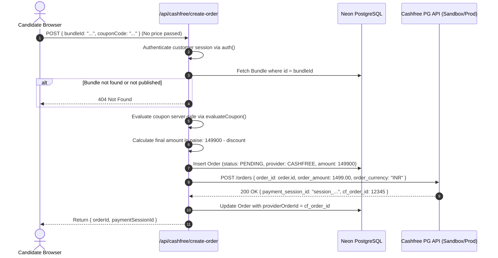

# Cashfree Payment Gateway Integration Specification

> **Status:** Planned — Not Implemented  
> **Priority:** Future work  
> **Payment provider:** Cashfree  
> **Current active provider:** Stripe (INR)  
> **Production activation:** Not authorized  

---

> [!IMPORTANT]
> **Specification Notice**  
> This document serves as an architectural blueprint and security specification for future implementation. It does **not** authorize execution, source code alteration, live payment activation, production database migrations, or credentials deployment. Any future implementation work must proceed only after explicit approval.

---

## Table of Contents
1. [Executive Summary & Objectives](#1-executive-summary--objectives)
2. [Existing Project Context & Architecture](#2-existing-project-context--architecture)
3. [Official Cashfree References](#3-official-cashfree-references)
4. [Mandatory Security Rules & Threat Model](#4-mandatory-security-rules--threat-model)
5. [Price-Tampering Defense Architecture](#5-price-tampering-defense-architecture)
6. [API & Webhook Architecture](#6-api--webhook-architecture)
7. [Database & Prisma Schema Specification](#7-database--prisma-schema-specification)
8. [Fulfillment, Access Control & Invoicing](#8-fulfillment-access-control--invoicing)
9. [Refund & Accounting Lifecycle](#9-refund--accounting-lifecycle)
10. [Environment Variables & Configuration](#10-environment-variables--configuration)
11. [Phased Implementation Workflow](#11-phased-implementation-workflow)
12. [Comprehensive Test Plan (Phases J & K)](#12-comprehensive-test-plan)
13. [Deployment & Production Approval Gates](#13-deployment--production-approval-gates)

---

## 1. Executive Summary & Objectives

The purpose of this specification is to define a production-grade, cryptographically verified integration of **Cashfree Payments** as an Indian domestic payment gateway (UPI, NetBanking, RuPay/Debit/Credit Cards) for the **ADC Exam Prep App**.

### Core Objectives
1. **Zero-Trust Client Design:** All prices, discounts, and payment sessions must be resolved server-side from authoritative database records.
2. **Side-by-Side Coexistence:** Preserve Stripe as an active INR payment provider. Existing historical orders, invoices, entitlements, and webhook records across Stripe, PayPal, and PayNow must remain intact without data loss or schema breaking changes.
3. **Replay & Tampering Immunity:** Enforce raw-body HMAC-SHA256 signature verification, timing-safe equality checks, timestamp replay guards, and database-backed idempotency.
4. **Authoritative Access Control:** Candidates may only receive exam attempt entitlements after verified successful provider settlement. Redirect URLs and browser state are never treated as proof of payment.

---

## 2. Existing Project Context & Architecture

The application currently operates on the following production stack:
- **Framework:** Next.js 16 (App Router), React 19, TypeScript
- **Hosting & Compute:** Vercel serverless runtime (Node.js engine)
- **Database:** Neon Serverless PostgreSQL with Prisma ORM
- **Authentication:** NextAuth / Auth.js (OAuth + Credentials/OTP sessions)
- **Current Active Provider:** Stripe Checkout (processing ₹1,499.00 INR via `src/app/api/stripe/create-order`)
- **Product & Pricing:** ADC Written Examination Preparation Bundle (`adc-written-exam-prep-bundle`):
  - Authoritative price in DB: **₹1,499.00**, stored strictly as **`149900` integer paise**.

### Existing File & Service Topology
```
src/
├── app/
│   ├── api/
│   │   ├── checkout/methods/route.ts       # Exposes enabled payment methods to client
│   │   ├── orders/[id]/status/route.ts     # Polling endpoint for checkout/processing
│   │   ├── attempts/start/route.ts         # Access gating (requires Entitlement)
│   │   ├── stripe/create-order/route.ts    # Existing Stripe order creator
│   │   └── stripe/webhook/route.ts         # Existing Stripe webhook processor
│   ├── checkout/
│   │   ├── bundle/[bundleId]/
│   │   │   └── bundle-checkout-client.tsx  # Checkout UI & payment picker
│   │   ├── processing/
│   │   │   └── processing-client.tsx       # Async status polling UI
│   │   ├── success/page.tsx                # Post-payment confirmation page
│   │   └── failed/page.tsx                 # Payment failure fallback page
│   └── admin-dashboard/
│       └── settings/
│           ├── groups.ts                   # Admin settings UI field definitions
│           └── payment/page.tsx            # Payment settings management
├── components/
│   └── checkout/
│       └── payment-methods.tsx             # Payment method selector component
└── lib/
    ├── fulfill.ts                          # Atomic order fulfillment & entitlement grant
    ├── settings.ts                         # AES-256-GCM encrypted DB settings engine
    ├── payments/
    │   ├── webhook-log.ts                  # Idempotent webhook logging (PaymentWebhookEvent)
    │   └── refund.ts                       # Unified refund orchestrator & credit note minter
    └── invoice/
        └── issue.ts                        # Legal GST invoice generation
```

---

## 3. Official Cashfree References

All future implementation work must consult these official references as the source of truth:

- **Cashfree Documentation Index:**  
  [https://www.cashfree.com/docs/llms.txt](https://www.cashfree.com/docs/llms.txt)
- **Cashfree Payments Developer Documentation:**  
  [https://www.cashfree.com/docs/](https://www.cashfree.com/docs/)
- **Cashfree Hosted Web Checkout / Create Order Flow:**  
  [https://www.cashfree.com/devstudio/preview/pg/web/checkout](https://www.cashfree.com/devstudio/preview/pg/web/checkout)
- **Cashfree Inline Checkout Reference:**  
  [https://www.cashfree.com/devstudio/preview/pg/web/inlineCheckout](https://www.cashfree.com/devstudio/preview/pg/web/inlineCheckout)
- **Cashfree Webhook Signature Verification:**  
  [https://www.cashfree.com/devstudio/preview/pg/tools/webhookVerification](https://www.cashfree.com/devstudio/preview/pg/tools/webhookVerification)
- **Cashfree Official Node.js SDK:**  
  [https://github.com/cashfree/cashfree-pg-sdk-nodejs](https://github.com/cashfree/cashfree-pg-sdk-nodejs)
- **Cashfree Pricing and Payment Gateway Charges:**  
  [https://www.cashfree.com/payment-gateway-charges/](https://www.cashfree.com/payment-gateway-charges/)
- **Cashfree Merchant Onboarding & Support:**  
  [https://www.cashfree.com/contact-us/](https://www.cashfree.com/contact-us/)
- **Cashfree Merchant Dashboard:**  
  [https://merchant.cashfree.com/](https://merchant.cashfree.com/)

**API Version Selected:** `2023-08-01`  
*Rationale:* This is Cashfree's stable, long-term supported API version across their web SDK (v3) and REST endpoints, offering standardized JSON structures for orders, refunds, and webhooks.

---

## 4. Mandatory Security Rules & Threat Model

Payment security is the highest priority. The following attack vectors must be rendered ineffective:

| Threat / Attack Vector | Exploitation Attempt | Mitigation Architecture |
| :--- | :--- | :--- |
| **Price Tampering** | Manipulating JavaScript state, modifying network payload to ₹1, ₹0, or negative amounts. | Server resolves bundle price strictly from database (`db.bundle.findUnique`). Client-submitted amounts are rejected or discarded. |
| **Currency Spoofing** | Sending USD or SGD to exploit foreign exchange rate calculations. | Currency is hardcoded to `INR` server-side and checked at order creation, webhook verification, and status reconciliation. |
| **Fake Success Redirect** | Customer navigates directly to `/checkout/success?orderId=...` or manipulates query params. | Entitlements are never unlocked via frontend routes. Protected exam routes check `Entitlement` rows in PostgreSQL, which can only be created by `fulfillOrder()` on verified payment. |
| **Webhook Replay Attack** | Intercepting a valid webhook and resending it multiple times. | Composite unique constraint `@@unique([provider, eventId])` in `PaymentWebhookEvent`. Retries are logged and immediately return HTTP 200 `{ ok: true, dedup: true }`. |
| **Webhook Signature Forgery** | Submitting fake `PAYMENT_SUCCESS_WEBHOOK` from unauthorized IPs. | Raw HTTP body extracted before JSON parsing. Verified with HMAC-SHA256 using `CASHFREE_SECRET_KEY` and timestamp header via `crypto.timingSafeEqual`. |
| **Timestamp Drift Exploitation** | Delayed or expired webhook replay. | Timestamp header inspected; drift exceeding 300 seconds is rejected. |
| **Race Conditions** | Multiple simultaneous webhook deliveries or parallel checkout requests. | Atomic PostgreSQL transactions (`db.$transaction`) ensure only one fulfillment process succeeds; second attempt detects `order.status === 'PAID'` and exits safely. |

---

## 5. Price-Tampering Defense Architecture

The client initiates checkout by submitting **only** the `bundleId`, optional `billingAddressId`, and optional `couponCode`.



### Boundary Conversion Rule
- **Internal Database:** Integer paise (`149900` paise).
- **Cashfree Gateway Boundary:** Decimal INR (`1499.00` INR = `order.amount / 100`).
- **Webhook Ingestion Boundary:** Convert Cashfree `payment_amount` back to paise (`Math.round(payment_amount * 100)`) and compare strictly with `order.amount`.

---

## 6. API & Webhook Architecture

### 1. Order Creation Endpoint: `POST /api/cashfree/create-order`
- **Authentication:** Required (NextAuth session).
- **Rate Limiting:** IP and user-level throttling.
- **Request Body:**
  ```json
  {
    "bundleId": "string (required)",
    "tier": "PRACTICE | VOUCHER (optional)",
    "billingAddressId": "string (optional)",
    "couponCode": "string (optional)"
  }
  ```
- **Response Body:**
  ```json
  {
    "orderId": "clx...",
    "paymentSessionId": "session_...",
    "cfOrderId": "12345678"
  }
  ```

### 2. Webhook Ingestion Endpoint: `POST /api/cashfree/webhook`
- **Request Headers Required:**
  - `x-webhook-timestamp`: Unix timestamp string.
  - `x-webhook-signature`: Base64 HMAC-SHA256 signature.
- **Signature Verification Algorithm:**
  ```ts
  const rawBody = await req.text();
  const signature = req.headers.get('x-webhook-signature');
  const timestamp = req.headers.get('x-webhook-timestamp');

  // Verify timestamp freshness (< 300 seconds)
  const age = Math.abs(Date.now() / 1000 - Number(timestamp));
  if (age > 300) return NextResponse.json({ error: 'timestamp_expired' }, { status: 400 });

  // Compute signature: HMAC-SHA256(timestamp + rawBody, CASHFREE_SECRET_KEY)
  const dataToSign = `${timestamp}${rawBody}`;
  const expectedSig = crypto
    .createHmac('sha256', secretKey)
    .update(dataToSign)
    .digest('base64');

  const isValid = crypto.timingSafeEqual(
    Buffer.from(signature, 'base64'),
    Buffer.from(expectedSig, 'base64')
  );
  if (!isValid) return NextResponse.json({ error: 'invalid_signature' }, { status: 400 });
  ```
- **Verification Gates Before Access:**
  1. Event type must be `PAYMENT_SUCCESS_WEBHOOK`.
  2. Order must exist in DB with `status: 'PENDING'`.
  3. `payment.payment_currency === order.currency` (`INR`).
  4. `Math.round(payment.payment_amount * 100) === order.amount`.
  5. If valid, invoke `fulfillOrder(order.id, payload, String(payment.cf_payment_id))`.

### 3. Server-to-Server Verification: `GET /api/cashfree/verify-order?orderId=...`
- Used by `/checkout/processing` fallback if webhooks are delayed.
- Queries Cashfree API: `GET {baseUrl}/orders/{order_id}/payments`.
- Inspects authoritative payment status directly from Cashfree before transitioning orders.

---

## 7. Database & Prisma Schema Specification

### Schema Modification (`prisma/schema.prisma`)
Add `CASHFREE` to the existing `PaymentProvider` enum:

```prisma
enum PaymentProvider {
  PAYPAL
  PAYNOW
  HITPAY
  STRIPE
  TEST
  CASHFREE
}
```

### Safety & Backward Compatibility Analysis
- **PostgreSQL Enum Addition:** Adding a value to an existing enum (`ALTER TYPE "PaymentProvider" ADD VALUE 'CASHFREE';`) is a non-blocking, instant DDL operation in PostgreSQL.
- **Existing Records Preserved:** Orders with `provider = 'STRIPE'`, `'PAYPAL'`, etc., remain completely unaffected.
- **Field Utilization:**
  - `Order.provider`: `'CASHFREE'`
  - `Order.providerOrderId`: Cashfree's `cf_order_id` (string/integer)
  - `Order.providerCaptureId`: Cashfree's `cf_payment_id`
  - `Order.providerPayload`: Complete Cashfree response snapshot (JSON)
  - `PaymentWebhookEvent.provider`: `'CASHFREE'`
  - `Refund.provider`: `'CASHFREE'`
  - `Refund.providerRefundId`: Cashfree `cf_refund_id`

---

## 8. Fulfillment, Access Control & Invoicing

Order fulfillment reuses the battle-tested, transactional [`fulfillOrder()`](file:///c:/Users/sukes/Downloads/ADC%20Exam%20Prep%20App/src/lib/fulfill.ts) function:

1. **Atomic State Transition:** Inside `db.$transaction`:
   - Checks `order.status !== 'PAID'`.
   - Flips `order.status = 'PAID'`.
   - Records `capturedAt = new Date()`.
2. **Entitlement Creation:**
   - Upserts `Entitlement` for `(userId, examId, tier)`.
   - If `tier === 'VOUCHER'`, schedules voucher delivery in `VoucherDelivery`.
3. **Legal Invoicing:**
   - Mints a sequential tax invoice (`INV-2026-xxxxx`) via `issueInvoiceForOrder()`.
4. **Asynchronous Notification:**
   - After transaction commits: generates PDF invoice (`pdfkit`) and dispatches purchase email (`sendPurchaseEmail`). Email errors are caught safely and do not roll back the paid order.

---

## 9. Refund & Accounting Lifecycle

Admin refunds are routed through [`src/lib/payments/refund.ts`](file:///c:/Users/sukes/Downloads/ADC%20Exam%20Prep%20App/src/lib/payments/refund.ts):

1. **Eligibility Check:** Order must be `PAID`; requested refund amount must not exceed `order.amount - alreadyRefunded`.
2. **Cashfree Refund API Invocation:**
   - **Endpoint:** `POST {baseUrl}/orders/{order_id}/refunds`
   - **Payload:**
     ```json
     {
       "refund_amount": 1499.00,
       "refund_id": "REF_cm12345...",
       "refund_note": "Candidate refund request"
     }
     ```
3. **Credit Note Generation:** Automatically mints a negative Credit Note invoice linked to the original invoice.
4. **Order State Update:** On full refund, transitions `order.status = 'REFUNDED'`.

---

## 10. Environment Variables & Configuration

### Required Server-Side Variables (Vercel & `.env`)
All keys must remain server-side and never be exposed in client bundles.

```ini
# Cashfree Payment Gateway (Server-side Only)
CASHFREE_APP_ID=your_cashfree_app_id_here
CASHFREE_SECRET_KEY=your_cashfree_secret_key_here
CASHFREE_ENV=TEST                        # 'TEST' (Sandbox) or 'PROD' (Production)
CASHFREE_API_VERSION=2023-08-01          # Official Cashfree API version
CASHFREE_ENABLED=false                   # Feature flag killswitch (default: false)

# Public Configuration (Safe for client bundle)
NEXT_PUBLIC_CASHFREE_ENV=sandbox         # 'sandbox' or 'production' for JS SDK loader
```

### Secret Key Encryption at Rest
Credentials entered via `/admin-dashboard/settings/payment` are encrypted using AES-256-GCM before writing to the database, ensuring zero plaintext exposure in database dumps.

---

## 11. Phased Implementation Workflow

```
┌─────────────────────────────────────────────────────────────┐
│  Phase 1: Database & Foundation                             │
│  - Add CASHFREE to PaymentProvider enum                     │
│  - Register encrypted settings in src/lib/settings.ts       │
│  - Build src/lib/payments/cashfree.ts gateway client        │
└──────────────────────────────┬──────────────────────────────┘
                               │
┌──────────────────────────────▼──────────────────────────────┐
│  Phase 2: API Routes & Webhook Engine                       │
│  - Create POST /api/cashfree/create-order                   │
│  - Create POST /api/cashfree/webhook (HMAC verification)    │
│  - Add Cashfree refund handling to src/lib/payments/refund  │
└──────────────────────────────┬──────────────────────────────┘
                               │
┌──────────────────────────────▼──────────────────────────────┐
│  Phase 3: Checkout UI & SDK Integration                     │
│  - Update src/components/checkout/payment-methods.tsx       │
│  - Integrate Cashfree JS SDK in bundle-checkout-client.tsx  │
│  - Connect /checkout/processing polling                     │
└──────────────────────────────┬──────────────────────────────┘
                               │
┌──────────────────────────────▼──────────────────────────────┐
│  Phase 4: Automated Testing & Validation                    │
│  - Execute 8 core test suites (price tampering, signature)   │
│  - TypeScript check (tsc --noEmit) & production build       │
└──────────────────────────────┬──────────────────────────────┘
                               │
┌──────────────────────────────▼──────────────────────────────┐
│  Phase 5: Merchant Review & Production Approval Gate        │
│  - Manual sandbox checkout validation                       │
│  - Written user approval required before production live     │
└─────────────────────────────────────────────────────────────┘
```

---

## 12. Comprehensive Test Plan

Automated test script (`scripts/test-cashfree-integration.ts`) must validate the following edge cases:

1. **Price Manipulation Defense:**
   - Attempt order creation with client-supplied price of ₹1, ₹0, or negative value.
   - *Pass Criteria:* Server ignores client values; order is minted with authoritative ₹1,499.00.
2. **Signature Verification:**
   - Valid HMAC signature accepted (HTTP 200).
   - Tampered payload or wrong secret rejected (HTTP 400).
3. **Replay Protection:**
   - Duplicate webhook delivery returns `{ ok: true, dedup: true }` without re-running fulfillment.
4. **Amount & Currency Mismatch:**
   - Payment webhook with `amount: 1.00` or `currency: "USD"` rejected (HTTP 400); no entitlement granted.
5. **Payment Failure & Cancellation:**
   - `PAYMENT_FAILED_WEBHOOK` or `PAYMENT_USER_DROPPED_WEBHOOK` marks order `FAILED`; no access granted.
6. **Refund Flow:**
   - Admin refund triggers Cashfree API, stores `cf_refund_id`, and creates a credit note.
7. **Stripe Regression Suite:**
   - Existing Stripe checkout, webhooks, and historical orders continue working with zero errors.

---

## 13. Deployment & Production Approval Gates

1. **Sandbox-Only Activation:** Initial testing must use Cashfree Sandbox credentials (`TEST` environment).
2. **Strict Gate 1 (Code Review):** All automated tests, typechecks, and lint checks must pass.
3. **Strict Gate 2 (Database Migration):** Prisma migration reviewed and applied without dropping existing data.
4. **Strict Gate 3 (Production Approval):** Cashfree will **not** be set as the default provider, enabled in production, or connected to live merchant credentials without explicit written authorization from the repository owner.
